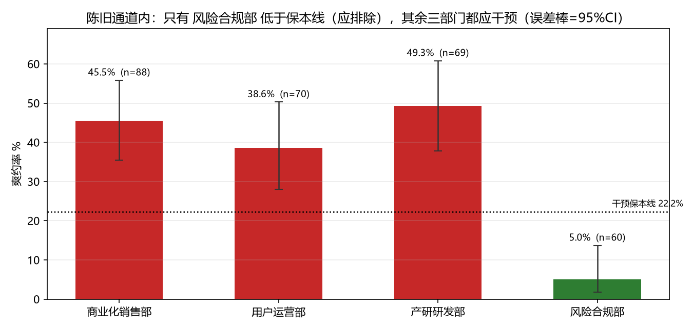
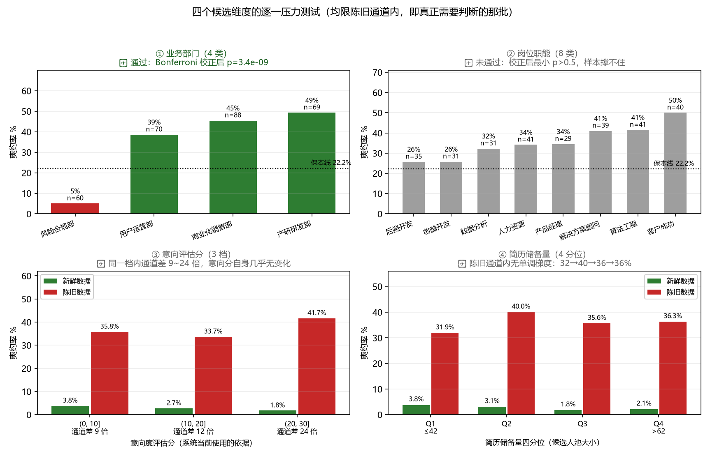

# 面试爽约的根因：邀约依据错了，而不是缺人提醒

> 关灯科技实战任务 · 张枭 · 2026-10-16
> 数据：`interview_invitations.csv`（仅使用本题发放数据，未引入任何外部或合成数据）

## 我的判断

### 我看到了什么

数据 1076 行，清洗后 994 条有效邀约（去掉 51 条完全重复行、31 条结果缺失），整体爽约率 **12.47%（124/994）**。

1. **系统明面上的决策依据没有区分度。** `intent_score`（意向度评估分，题面说"分数越低代表意愿越低"）与爽约的 AUC = **0.498**——等于抛硬币。按意向分档看爽约率是 U 形起伏（16.2% / 10.0% / 12.3% / 12.6% / 9.1% / 14.7%），最高意愿档（25–30）反而比最低档还高。
2. **真正有区分度的字段被闲置了。** `profile_synced_at`（活跃状态最后上报时间）与邀约时间的间隔，AUC = **0.807**。
3. **按题目给的口径算，无差别干预是净亏的。** 保本率 = 20 / 90 = **22.22%**，而整体爽约率只有 12.47%。全量做二次确认的净收益是 **−8720 小时**。
4. **陈旧通道内部不是铁板一块，藏着一个"免疫"部门。** 同样是 > 18 分钟，风险合规部爽约率只有 **5.0%**（n=60），其余三部门 **44.5%**（n=227）——Fisher 精确检验 p=8.4e-10，四选一做 Bonferroni 校正后 p=3.4e-09 仍显著，两组 95% 置信区间完全不重叠，且在 18/24/30/36/48 分钟各档阈值下全部成立。而风险合规部在**新鲜**通道内反而略高（4.0% vs 全体 2.8%）——它不是"整体更靠谱"，是**"即使数据陈旧也仍会出席"**，这是真正的**通道 × 部门交互效应**。
5. **四个候选维度做了逐一压力测试，只有一个通过。** 对业务部门、岗位职能、意向评估分、简历储备量这四个天然候选维度，统一限定在陈旧通道内（真正需要判断的那 287 条）用同一标准检验：
   - **业务部门**：✅ 通过（p=8.4e-10，校正后 3.4e-09）；
   - **岗位职能**：❌ 极差看着有 24 个百分点（客户成功 50.0% vs 后端开发 25.7%），但 8 选 1 Bonferroni 校正后最小 p 仍 > 0.5，每组仅 20~40 条——**统计上撑不住，不下结论**；
   - **意向评估分**：❌ 控制通道后，同一意向档内新/陈旧差 **9.3 / 12.4 / 23.5 倍**，而意向分自身在通道内的波动只有 2 个百分点——**它造成的差异量级是"个位数百分点"，它没看的字段量级是"二十多倍"**；
   - **简历储备量**：❌ 陈旧通道内四分位 31.9/40.0/35.6/36.3，无单调梯度。

### 根问题是什么

**邀约决策的依据错了：系统信"分数"，不信"时效"。**

活跃状态的上报新鲜度存在一条 **18 分钟的硬边界**：

| 间隔 | 条数 | 爽约率 |
|---|---|---|
| ≤ 18 分钟 | 707 | **2.83%** |
| > 18 分钟 | 287 | **36.24%**（12.8 倍） |

关键在于**这不是一条渐变曲线，而是断崖**：18～22 分钟之间**零观测**，而且新鲜通道的上界正好压在 18.00 分钟这一点上（该点聚集了 50 条记录）。如果爽约是"意愿随时间衰减"，应该看到缓坡；看到的是纯空档加阶跃，这是**两套取数逻辑在切换**的指纹——更像是邀约系统里有两条取数管道（一条实时拉"刚活跃过"的人，一条从快照/批处理里拉），陈旧那条把早已离席的人当成在座的人发了邀约。

**部门之间的大部分差异是通道的表象，但不是全部。** 不分层时四个部门爽约率从 4.2% 到 18.2%，相差 14.0 个百分点；按通道分层后，新鲜通道内只剩 2.1%～4.0%（差 1.8 个百分点）——其中 **12.2 个百分点纯粹是"谁的邀约更多走了陈旧通道"**（商业化销售部 35.6% vs 风险合规部 25.3%）。`pool_size` 的表观效应（AUC 0.573）分层后同样消失（陈旧通道内 36.6% vs 36.0%），它只是通道构成的代理变量。**但陈旧通道内的部门差异没有消失**：风险合规部 5.0% 对其余三部门 38.6%～49.3%——这个差不能被"走哪条通道"解释（四个部门都已限定在陈旧通道内），也不能被"陈旧多久"解释（两组的 stale_h 分布几乎相同，均值 0.774h vs 0.779h、中位 0.742h vs 0.767h，出处 report.txt 四·检验A）。所以在根因层上，**通道是主因，风险合规部在陈旧通道上另有一条独立的免疫**。

### 所以我决定做什么 —— 以及不做什么

**做**：对"活跃状态同步超过 18 分钟**且部门 ≠ 风险合规部**"的邀约做提前意向二次确认（共 227 条，占 23%）。两个条件的理由各自独立：前者把命中率从 12.5% 提到 44.5%，后者把那 60 条必然亏损的记录剔掉。

**不做**（每一条都有数字理由）：

- **不按 `intent_score` 挑人**：各档净收益全为负（最好的一档 −1460 小时，最差 −4440 小时）。它当前是系统的主依据，这是最需要先停掉的事。
- **不对新鲜通道（707 条）做任何干预**：爽约率 2.83%，远低于 22.22% 保本线，覆盖它们要多花 14140 小时。
- **不按部门做"多干预/少干预"的整体配额**：新鲜通道内四部门只差 1.8 个百分点，那 14 个百分点的表观差异基本是"谁的邀约更多走了陈旧通道"造成的。**唯一的例外是风险合规部**——不是"给它少配点额度"，是**完全不干预**（5.0% 远低于 22.22% 保本线，干预净收益 −930 小时）。
- **不把 18 分钟阈值推后追那多出的 120 小时**：阈值扫描最优点在 22~23 分钟（净收益 +3740 小时，比 18 分钟多 120 小时），但走到那里必须把 22~23 分钟仅有的 6 条观测（全部未爽约）一并排除——靠 6 条样本定边界是过拟合。18.00 分钟这一点有 50 条、爽约率 4.0%，是密集观测区的边界。**放弃 3.3% 的收益换稳健性。**
- **不建多特征模型**：单变量已经给出 AUC 0.807 和一条可解释的硬边界；在 n=994 上叠模型只会增加无法核对的复杂度，30 分钟内也讲不清每个系数。

## 做了什么

1. **数据体检与清洗**（`interview_no_show.py` 前 80 行）：
   - 去掉 51 条完全重复行（唯一 `invitation_id` 恰好也是 1025，确认是整行重复而非同 id 多条）；
   - **时区对齐**：`invited_at` 带 `+08:00`，`profile_synced_at` 是 UTC（`Z`）。先归一到同一时区再相减，否则每条记录凭空多 8 小时（归一后中位 0.217h，忽略时区会算出 8.217h）；
   - 31 条 `is_completed` 缺失（3.0%），分散均匀，按缺失处理。
2. **单变量区分度**：对三个数值字段算 AUC（秩和法）。
3. **根因定位**：对活跃新鲜度做 5 分钟分箱，发现断崖；检查 18～22 分钟区间的观测数。
4. **反例检验**（不是只找支持自己结论的证据）：
   - 部门差异分层前后对比；
   - **陈旧通道内部门交互检验**（Fisher 精确检验 + Bonferroni 校正 + Wilson 置信区间 + 5 档阈值稳健性 + 新鲜通道反向印证）；
   - **替代解释排查**（检验 E）：风险合规部的效应是否只是"岗位职能构成"混杂？卡方检验显示该部门与其他部门的职能分布无显著差异（chi2=6.96, dof=7），且**8/8 个职能内部该部门都更低**（3 个职能单独显著）——效应跨全部职能稳定，不是职能带出来的；
   - **同标准对照**（检验 F）：岗位职能本身用完全相同的检验（8 选 1 Bonferroni），**全部不显著**——与部门检验一过一不过，说明筛选标准是统计检验而不是"看起来差得多"；
   - **意向分效应量级对比**（检验 G）：分档 × 通道交叉表 + 相关系数（intent 与 stale_h r=−0.02，几乎正交，它不是任何东西的代理变量，就是没有信息）；
   - `pool_size` 四分位在通道内无单调梯度（结论：都没有信号）；
   - **阈值全扫描**（5~78 分钟逐分钟，确认 18 分钟不是净收益最优点但仍是稳健选择）；
   - 成本敏感性（干预有效率需要多高才划算）。
5. **决策规则与净收益测算**：9 条候选规则统一按 `拦截爽约×90 − 干预数×20` 计分。
6. 产出：`output/report.txt`（全部数字）+ 7 张图（`output/fig_*.png`），其中 `fig_dimensions.png` 是四个候选维度的逐一压力测试总览。

## 怎么证明有用

### 主结论

**对"活跃状态同步超过 18 分钟且部门 ≠ 风险合规部"的 227 条邀约做二次确认，可以覆盖 81.5% 的爽约（101/124），命中率 44.5%，净收益 +4550 小时；而按现有依据（意向分）挑人，怎么做都是亏的。**

（保守版——只按 18 分钟、不区分部门：干预 287 条，覆盖 83.9%，命中率 36.2%，净收益 +3620 小时。排除风险合规部后少干预 60 条省 1200 小时，只少拦 3 次爽约少挽回 270 小时，**净多得 +930 小时（+26%）**。）

### 证据链

| 证据 | 数字 | 出处（可由发放数据算出） |
|---|---|---|
| 整体爽约率 | 12.47%（124/994） | `interview_no_show.py` `load()`，report.txt 一 |
| 干预保本线 | 20/90 = 22.22% | 题目口径，report.txt 一 |
| `intent_score` 无区分度 | AUC 0.498 | `auc()`，report.txt 二 |
| `intent_score` 六档明细 | 16.2 / 10.0 / 12.3 / 12.6 / 9.1 / 14.7%（U 形，非单调） | report.txt 二 |
| 新鲜度区分度 | AUC 0.807 | `auc()`，report.txt 二 |
| 断崖两侧 | ≤18min 2.83% (707) vs >18min 36.24% (287) | report.txt 三 |
| 18～22 分钟零观测 | 观测数 = 0（22/23 分钟另有 6 条，全部未爽约） | report.txt 三 |
| 阈值全扫描 | 最优点 23min +3740h，取 18min +3620h，放弃 3.3% | report.txt 三 |
| 部门差异被通道解释（新鲜通道内） | 14.0pp → 1.8pp | report.txt 四 |
| **陈旧通道内的部门例外** | 风险合规部 5.0%(n=60) vs 其他 44.5%(n=227)，Fisher p=8.4e-10 | report.txt 四 [检验A] |
| **两组的陈旧程度几乎相同** | stale_h 均值 0.774h vs 0.779h、中位 0.742h vs 0.767h | report.txt 四 [检验A] |
| **替代解释排查（职能混杂）** | 职能分布 chi2=6.96(dof=7)；8/8 个职能内部风控都更低 | report.txt 四 [检验E] |
| **同标准对照：职能无效应** | 8 选 1 校正后最小 p>0.5，全部不显著 | report.txt 四 [检验F] |
| **意向分效应量级** | 同一意向档内通道差 9.3/12.4/23.5 倍；r(intent, stale_h)=−0.02 | report.txt 四 [检验G] |
| 推荐规则净收益 | 101×90 − 227×20 = **+4550 h** | `ev()`，report.txt 五（规则⑦） |
| 保守版（不排除部门） | 104×90 − 287×20 = **+3620 h** | 同上（规则③） |
| 全量干预净收益 | 124×90 − 994×20 = **−8720 h** | 同上 |
| 按意向分最好一档 | intent≤5：−1460 h | 同上 |


绿色（≤18 分钟）全部在 2%～4%；跨过 18 分钟直接跳到 19%～51%。空档说明这不是衰减曲线。


橙色（不分层）差异 14 个百分点；绿色（新鲜通道内）四部门几乎一样高——这部分差异被通道构成解释；但注意红色（陈旧通道内）那根最短的是风险合规部，它**没有**消失。


陈旧通道内逐部门的爽约率（误差棒 = 95% Wilson 置信区间）。三个部门都在保本线 22.2% 之上且置信区间不相交，只有风险合规部（绿色）低于保本线——给它做二次确认是净亏，必须排除。


同一口径下，只有"按新鲜度挑人"是正收益；按意向分挑人全是负收益。⑦（排除风险合规部）比③（不排除）再多 +930 小时。


四个候选维度统一在陈旧通道内用同一标准检验：部门通过（校正后 p=3.4e-09），职能未通过（校正后最小 p>0.5），意向分在同一档内被通道拉开 9~24 倍而自身几乎无变化，储备量无单调梯度。**筛选标准是统计检验，不是"看起来差得多"。**

其余图：`fig_gap.png`（18～22 分钟零观测的直方图）、`fig_intent.png`（意向分 U 形无区分度）。

### 为什么这不是巧合

- **阈值不敏感**：分界取 18～22 分钟之间任意值，分组结果完全相同（该区间零观测），不存在"挑了一个刚好好看的数"。再往外扫，最优点确实在 22～23 分钟（多 +120 小时），但那是 6 条样本撑出来的，详见「不做什么」第 4 条——我宁可放弃它。
- **方向反证**：如果根因是"部门管理松/候选人质量差"，那么同一部门内部、同一通道内的爽约率应当仍有明显差异——新鲜通道内确实没有（四部门只差 1.8 个百分点）。陈旧通道内的风险合规部例外，**正是靠这个检验找出来的**（反向印证：它在新鲜通道内反而略高，4.0% vs 2.8%，所以是交互效应不是主效应）。
- **代理变量检验**：`pool_size` 的表观信号在分层后消失（36.6% vs 36.0%），说明它不是独立原因。
- **数据自洽**：时差为负的记录 0 条；重复行去掉后 `invitation_id` 唯一数正好等于行数；缺失标签分散均匀。

## 我的假设

题目没明确、我自己拍板的地方：

- **[假设] 二次确认的"有效率"不是 100%。** 题目只给了成本（20 小时/次），没给成功率。上表按 100% 有效计算。保本条件是：`有效率 × 该组爽约率 > 22.2%`。对推荐组（爽约率 44.5%），**有效率 > 50% 即划算**（保守版 36.2% 时需要 > 61%——排除风险合规部除了多赚钱，还顺带把对有效率的要求降了 11 个百分点）；若实际有效率低于此线，则任何干预都不划算，应先小流量测出真实有效率再铺开。
- **[假设] 风险合规部的"免疫"效应可复现。** 它是事后发现的（4 个部门里挑最极端的那个）。虽然 Bonferroni 校正后仍显著、效应量巨大（5.0% vs 44.5%）、各档阈值下稳定，但仍应在新数据或 A/B 中复核后再固化成规则，不能直接当长期配额。
- **[假设] "爽约损失 90 小时"按每次爽约计**，不随部门/职能变化。
- **[假设] `is_completed=0` 视为"候选人临时失约"**，题目口径如此；31 条缺失不代表爽约，已剔除。
- **[假设] "两条取数管道"是对断崖的一种机制解释**，本题数据无法直接验证管道的存在（没有管道标识字段）。但"断崖 + 空档 + 上界恰好压在整数分钟"这三点共同指向机制切换而非自然衰减，这一点不依赖解释成立——**无论机制是什么，18 分钟这条边界本身就是可操作的干预依据**。

## 局限与下一步

- **数据层面**：只有 7 天窗口（9/1–9/7），无法验证周内/季节性；`is_completed` 缺失 3.0%；没有"面试scheduled时间"字段，算不出"提前几天邀约"对爽约的影响；没有渠道/来源字段，无法区分主动投递与系统拉人。
- **分析层面**：风险合规部的"免疫"已被隔离出来并做进规则（不再是"拆不开"），但**它为什么存在**是数据回答不了的——可能性：该部门的候选人池更稳定（编制内岗位）、或它走的是另一条取数管道、或招聘流程本身更长、候选人沉没成本更高。这需要业务侧确认；在确认前，**这条规则要带着 post-hoc 的标签上线**。二次确认的真实有效率未知（见假设）。
- **净收益是样本内（in-sample）估计，偏差方向必然乐观**：阈值和"免疫部门"都是在这 994 条里挑出来的，收益又用同一批数据算——等于拿答案反推答案。真实上线收益会低于 +4550 h，低多少在本题数据里估不出来。所以上线的判据不是"+4550 h"这个数，而是"有效率 > 50%"这条对真实有效率的容错线；要去偏只能换一批数据或 A/B 复算（见下条"给 1 周"）。
- **给 1 周**：上线"18 分钟"闸门做 A/B——把 >18 分钟且非风险合规部的邀约随机分两组，一组做二次确认一组不做，用真实数据测出有效率和净收益，替掉我这里的 100% 有效假设；同一批实验里顺手验证风险合规部的免疫是否复现。
- **给 1 个季度（根治）**：这是全栈问题，不只是分析问题。建议在邀约 pipeline 发出前加一道 **fail-closed 自检**：`profile_synced_at` 距今 > 18 分钟就拒绝自动发送、转人工或触发重新拉取——任何一条被绕过就直接告警。同时给陈旧通道加埋点（管道标识、数据来源），下次这类问题可以直接归因，不用再靠时间戳反推；也去搞清楚风险合规部那 5% 背后到底是什么机制——如果它是个可复制的条件（比如某种确认流程），那才是比"排除它"值钱得多的东西。

## 如何复现

```bash
pip install pandas numpy matplotlib
python interview_no_show.py                    # 默认读 data/interview_invitations.csv
python interview_no_show.py 路径/to/file.csv   # 或显式指定
```

产出 `output/report.txt`（README 里每个数字都能在其中找到）与 `output/fig_*.png`。
脚本只用标准科学计算栈，无随机数、无外部数据，重跑结果逐字节一致。

## 改动记录

- **本次 4（最新提交）——一致性复核：修掉一个错数、补齐两处证据链**：
  - **修掉一个错数（本次最实质的改动）**：README 原文写"两组的 stale_h 均值 0.69h vs 0.71h"，复核发现**任何口径都算不出这两个值**（真值：均值 0.774h vs 0.779h，中位 0.742h vs 0.767h）。这句话所在的论证是"部门差异不能用陈旧时长解释"，数字错了这条论证就悬空。已改正，并把两组均值打印进 `report.txt` 四·检验A。
  - **补齐两处证据链**：意向分六档明细（16.2 / 10.0 / 12.3 / 12.6 / 9.1 / 14.7%）与上面那两个均值，此前只写在 README、`report.txt` 里没有，违反第 11 节"每个进 README 的数字都能在 `report.txt` 里找到"的自设规矩。已在 `interview_no_show.py` 里补打印。
  - **补一条样本内偏差声明**：净收益是"同一批数据既用来选规则、又用来算收益"的产物，偏差方向必然乐观，真实上线收益会低于 +4550 h。此前没写，容易被"这个数靠谱吗"问住。
  - **三处表述修正**：脚本 docstring 写"6 张图"、实际输出 7 张；`fig_gap` 标题把"取数通道"从断言降为假设（与"机制解释只作假设"的原则一致）；规则表里"需有效率>178%"是不可能达成的门槛，改为"即使二次确认 100% 有效也仍亏损"。
  - 结论与全部数字**未改动**；重跑两次 `report.txt` 逐字节一致。

- **上一版 3（commit `c6585fa`）——四维度压力测试：把"剩下的候选解释"全部验完**：
  - **新增检验 E（替代解释排查）**：风险合规部的"免疫"是否只是岗位职能构成混杂？卡方显示其职能分布与其他部门无显著差异（chi2=6.96, dof=7），且 **8/8 个职能内部该部门都更低**（3 个单独显著）——效应跨全部职能稳定，排除混杂解释。
  - **新增检验 F（同标准对照）**：岗位职能本身用完全相同的检验，8 选 1 Bonferroni 校正后**全部不显著**（极差看着有 24 个百分点，但每组仅 20~40 条）——与部门检验一过一不过，说明筛选靠统计不靠观感。
  - **新增检验 G（效应量级对比）**：意向分各档内新/陈旧差 9.3/12.4/23.5 倍，而意向分自身波动仅 2pp；r(intent, stale_h)=−0.02，它不是任何东西的代理变量，就是没有信息。
  - **新增图 `fig_dimensions.png`**（四维度压力测试总览）与第六节两条新的"不做"（不按职能干预、不按储备量干预，各附检验数字）。
  - 既往结论**均未推翻**；本次是把"这四个维度为什么只用了部门"这个问题回答完整。
- **上一版 2（commit `19ff390`）——结论层面的实质改进，不只是文档**：
  - **修正一处过度概括**：初版 README 说「不按部门/职能单独干预，分层后部门差异只剩 1.8 个百分点」——这句话只用了**新鲜通道**的分层结果。复审发现**陈旧通道内的部门差异根本没消失**：风险合规部 5.0%（n=60）vs 其余三部门 44.5%（n=227），Fisher p=8.4e-10、Bonferroni ×4 后 3.4e-09、CI 不重叠、5 档阈值下全部成立。这不是"小的残余因素"，是全数据里最强的信号之一。**是我初版分析时漏掉的**，不是数据问题。
  - **推荐规则升级**：从「陈旧 > 18min」（+3620 h）改为「**陈旧 > 18min 且 部门 ≠ 风险合规部**」（**+4550 h，+26%**）。被排除的 60 条爽约率仅 5.0%，干预净收益 −930 小时。
  - **补齐一处表述不精确**：22.0/23.0 分钟另有 6 条观测且全部未爽约，真正的爽约跳变发生在 23→24 分钟。阈值全扫描显示净收益最优点在 23 分钟（+3740 h），但那是 6 条样本撑出来的，**主动放弃这 120 小时换稳健性**。
  - **脚本与图表**：新增 `wilson_ci` / `fisher_two_sided` 两个统计函数、阈值全扫描、陈旧通道内部门交互检验（检验 A~D）、新图 `fig_interaction.png`；`fig_simpson` 标题从「部门差异是假的」改为更准确的表述。候选规则从 6 条增到 9 条（新增⑦⑧）。
  - **改动可复现**：重跑 `python interview_no_show.py` 后 `output/report.txt` 与本 README 逐条对账。
  - 既往结论（断崖、intent_score 无区分度、时区坑、pool_size 代理变量）**均未推翻，保持不变**；本次是"在陈旧通道内进一步分层"的增量发现。
- **上一版 1（文档修订）——只改 `README` / `AI_LOG`，分析结论与全部数字未动**：修正 `AI_LOG.md` 里对分工的**过度自我贬低**。上一版为了"不代写"走向另一个极端，写成"全程只有 3~4 条人工指令"，反而漏掉了四次有实质影响的介入（定术语口径、质询文档真实性、指出可改进项、决策与环境操作）。已改为如实的分工表，并新增第 8 条——**AI 曾把 agent 自查的修正填进「我的提示词」栏，是我质询后核出来的**。`AI_LOG` 的校验协议盲区也从两条补到三条（新增"归因真实性"）。
- **上一版（commit `c465f20`）——只改文档，未动分析**：修正 `AI_LOG.md` 的真实性。初稿里第 3~6 条标着「我的提示词（原文）」的句子，**是 AI 事后补写的拟稿**（不是我写的，也不是我说过的），当时的真实指令其实只有 3 条。已改为如实标注：那几轮**没有人工输入，是 agent 自查触发**的修正，不伪装成"我审出来的"。同时补上第 7 条（用别的仓库代验推送链路、结果在目标仓库上 403 的错误）。
- **首版（commit `3dfc2cc`，2026-10-16 16:52）**：首次交付。

## AI 使用

关键交互（含 AI 出错与修正）见 `AI_LOG.md`。

真实分工：**分析与实现由对话式 AI agent 端到端执行，我负责设定分析框架、关键决策与真实性核查。** 我介入过六次，原文均记录在 `AI_LOG.md` 中：

1. **定术语口径**——明确交付物的措辞红线；
2. **质询文档真实性**——读交付物时追问一处像占位符的文字，由此核出 AI 曾把 agent 自查的修正填进「我的提示词」栏（见 `AI_LOG.md` 第 8 条）；
3. **指出可改进项**——交付后要求再复审一轮，由此发现初版一处结论层的过度概括并升级了推荐规则（见第 9 条）；
4. **指定分析维度**——要求对部门、岗位职能、意向评估分、简历储备量做细致分析，而不是停留在"哪个字段有用"的单变量层面；由此补齐了替代解释排查（检验 E/F/G）和四维度压力测试图（见第 10 条）；
5. **决策与环境操作**——定改不改、何时重新提交，以及处理 GitHub 凭据权限（agent 无此权限，见第 7 条）；
6. **定复审的验收标准**——要求把待改项按「必改 / 可以改 / 不能改」三分类、给出三套方案并逐套打分，≥90 分才允许动手。这一轮复核因此抓出一个错数——README 里一个写错的均值（见第 12 条）。

`AI_LOG.md` 第 11 节写明这套自查协议**能抓什么、抓不到什么**：它擅长"数字 ↔ 脚本 ↔ 文档"的内部自洽，对**外部真实性**（环境能不能推、结论能不能推广、一句话是谁说的、分析框架够不够宽）无能为力——四个盲区各有上面的一次翻车对应。
