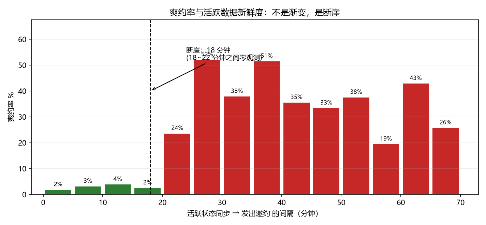
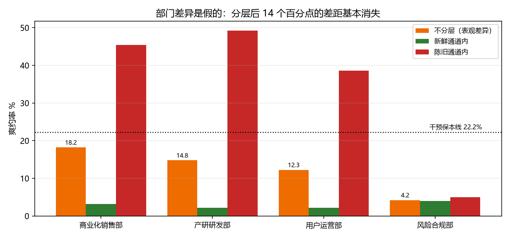
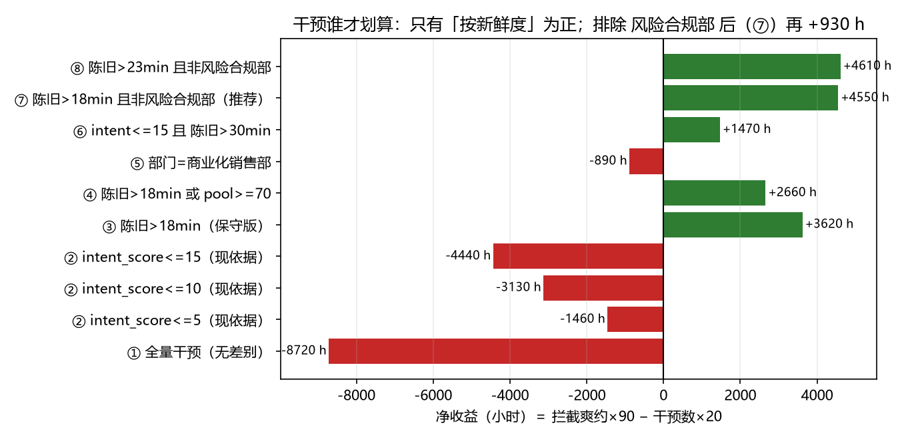

# 面试爽约的根因：邀约依据错了，而不是缺人提醒

> 关灯科技实战任务 · 张枭 · 2026-10-16
> 数据：`interview_invitations.csv`（仅使用本题发放数据，未引入任何外部或合成数据）

## 我的判断

### 我看到了什么

数据 1076 行，清洗后 994 条有效邀约（去掉 51 条完全重复行、31 条结果缺失），整体爽约率 **12.47%（124/994）**。

1. **系统明面上的决策依据没有区分度。** `intent_score`（意向度评估分，题面说"分数越低代表意愿越低"）与爽约的 AUC = **0.498**——等于抛硬币。按意向分档看爽约率是 U 形起伏（16.2% / 10.0% / 12.3% / 12.6% / 9.1% / 14.7%），最高意愿档（25–30）反而比最低档还高。
2. **真正有区分度的字段被闲置了。** `profile_synced_at`（活跃状态最后上报时间）与邀约时间的间隔，AUC = **0.807**。
3. **按题目给的口径算，无差别干预是净亏的。** 保本率 = 20 / 90 = **22.22%**，而整体爽约率只有 12.47%。全量做二次确认的净收益是 **−8720 小时**。

### 根问题是什么

**邀约决策的依据错了：系统信"分数"，不信"时效"。**

活跃状态的上报新鲜度存在一条 **18 分钟的硬边界**：

| 间隔 | 条数 | 爽约率 |
|---|---|---|
| ≤ 18 分钟 | 707 | **2.83%** |
| > 18 分钟 | 287 | **36.24%**（12.8 倍） |

关键在于**这不是一条渐变曲线，而是断崖**：18～22 分钟之间**零观测**，而且新鲜通道的上界正好压在 18.00 分钟这一点上（该点聚集了 50 条记录）。如果爽约是"意愿随时间衰减"，应该看到缓坡；看到的是纯空档加阶跃，这是**两套取数逻辑在切换**的指纹——更像是邀约系统里有两条取数管道（一条实时拉"刚活跃过"的人，一条从快照/批处理里拉），陈旧那条把早已离席的人当成在座的人发了邀约。

**部门之间的差异也是这个根因的表象，不是另一个原因。** 不分层时四个部门爽约率从 4.2% 到 18.2%，相差 14.0 个百分点；按通道分层后，新鲜通道内只剩 2.1%～4.0%（差 1.8 个百分点）——其中 **12.2 个百分点纯粹是"谁的邀约更多走了陈旧通道"**（商业化销售部 35.6% vs 风险合规部 25.3%）。`pool_size` 的表观效应（AUC 0.573）分层后同样消失（陈旧通道内 36.6% vs 36.0%），它只是通道构成的代理变量。

### 所以我决定做什么 —— 以及不做什么

**做**：把"活跃状态同步超过 18 分钟"作为唯一干预条件，对这 29% 的邀约做提前意向二次确认。

**不做**（每一条都有数字理由）：

- **不按 `intent_score` 挑人**：各档净收益全为负（最好的一档 −1460 小时，最差 −6030 小时）。它当前是系统的主依据，这是最需要先停掉的事。
- **不对新鲜通道（707 条）做任何干预**：爽约率 2.83%，远低于 22.22% 保本线，覆盖它们要多花 14140 小时。
- **不按部门/职能单独干预**：分层后部门差异只剩 1.8 个百分点，按部门切是拿表象当原因。
- **不建多特征模型**：单变量已经给出 AUC 0.807 和一条可解释的硬边界；在 n=994 上叠模型只会增加无法核对的复杂度，30 分钟内也讲不清每个系数。

## 做了什么

1. **数据体检与清洗**（`interview_no_show.py` 前 80 行）：
   - 去掉 51 条完全重复行（唯一 `invitation_id` 恰好也是 1025，确认是整行重复而非同 id 多条）；
   - **时区对齐**：`invited_at` 带 `+08:00`，`profile_synced_at` 是 UTC（`Z`）。先归一到同一时区再相减，否则每条记录凭空多 8 小时（归一后中位 0.217h，忽略时区会算出 8.217h）；
   - 31 条 `is_completed` 缺失（3.0%），分散均匀，按缺失处理。
2. **单变量区分度**：对三个数值字段算 AUC（秩和法）。
3. **根因定位**：对活跃新鲜度做 5 分钟分箱，发现断崖；检查 18～22 分钟区间的观测数。
4. **反例检验**（不是只找支持自己结论的证据）：
   - 部门差异分层前后对比；
   - `pool_size`、`intent_score` 在通道内是否仍有信号（结论：都没有）；
   - 阈值敏感性（18～22 分钟之间任意取值结果相同）；
   - 成本敏感性（干预有效率需要多高才划算）。
5. **决策规则与净收益测算**：8 条候选规则统一按 `拦截爽约×90 − 干预数×20` 计分。
6. 产出：`output/report.txt`（全部数字）+ 5 张图（`output/fig_*.png`）。

## 怎么证明有用

### 主结论

**对"活跃状态同步超过 18 分钟"的 287 条邀约做二次确认，可以覆盖 83.9% 的爽约（104/124），净收益 +3620 小时；而按现有依据（意向分）挑人，怎么做都是亏的。**

### 证据链

| 证据 | 数字 | 出处（可由发放数据算出） |
|---|---|---|
| 整体爽约率 | 12.47%（124/994） | `interview_no_show.py` `load()`，report.txt 一 |
| 干预保本线 | 20/90 = 22.22% | 题目口径，report.txt 一 |
| `intent_score` 无区分度 | AUC 0.498 | `auc()`，report.txt 二 |
| 新鲜度区分度 | AUC 0.807 | `auc()`，report.txt 二 |
| 断崖两侧 | ≤18min 2.83% (707) vs >18min 36.24% (287) | report.txt 三 |
| 18～22 分钟零观测 | 观测数 = 0 | report.txt 三 |
| 部门差异被通道解释 | 14.0pp → 1.8pp | report.txt 四 |
| 推荐规则净收益 | 104×90 − 287×20 = **+3620 h** | `ev()`，report.txt 五 |
| 全量干预净收益 | 124×90 − 994×20 = **−8720 h** | 同上 |
| 按意向分最好一档 | intent≤5：−1460 h | 同上 |


绿色（≤18 分钟）全部在 2%～4%；跨过 18 分钟直接跳到 19%～51%。空档说明这不是衰减曲线。


橙色（不分层）差异 14 个百分点；绿色（新鲜通道内）四部门几乎一样高。部门差异被通道构成解释。


同一口径下，只有"按新鲜度挑人"是正收益；按意向分挑人全是负收益。

其余图：`fig_gap.png`（18～22 分钟零观测的直方图）、`fig_intent.png`（意向分 U 形无区分度）。

### 为什么这不是巧合

- **阈值不敏感**：分界取 18～22 分钟之间任意值，分组结果完全相同（该区间零观测），不存在"挑了一个刚好好看的数"。
- **方向反证**：如果根因是"部门管理松/候选人质量差"，那么同一部门内部、同一通道内的爽约率应当仍有明显差异——实际新鲜通道内四部门差距只有 1.8 个百分点。
- **代理变量检验**：`pool_size` 的表观信号在分层后消失（36.6% vs 36.0%），说明它不是独立原因。
- **数据自洽**：时差为负的记录 0 条；重复行去掉后 `invitation_id` 唯一数正好等于行数；缺失标签分散均匀。

## 我的假设

题目没明确、我自己拍板的地方：

- **[假设] 二次确认的"有效率"不是 100%。** 题目只给了成本（20 小时/次），没给成功率。上表按 100% 有效计算。保本条件是：`有效率 × 该组爽约率 > 22.2%`。对推荐组（爽约率 36.2%），**有效率 > 61% 即划算**；若实际有效率低于 61%，则任何干预都不划算，应先小流量测出真实有效率再铺开。
- **[假设] "爽约损失 90 小时"按每次爽约计**，不随部门/职能变化。
- **[假设] `is_completed=0` 视为"候选人临时失约"**，题目口径如此；31 条缺失不代表爽约，已剔除。
- **[假设] "两条取数管道"是对断崖的一种机制解释**，本题数据无法直接验证管道的存在（没有管道标识字段）。但"断崖 + 空档 + 上界恰好压在整数分钟"这三点共同指向机制切换而非自然衰减，这一点不依赖解释成立——**无论机制是什么，18 分钟这条边界本身就是可操作的干预依据**。

## 局限与下一步

- **数据层面**：只有 7 天窗口（9/1–9/7），无法验证周内/季节性；`is_completed` 缺失 3.0%；没有"面试scheduled时间"字段，算不出"提前几天邀约"对爽约的影响；没有渠道/来源字段，无法区分主动投递与系统拉人。
- **分析层面**：陈旧通道内风险合规部仍显著更低（5.0% vs 其他部门 38.6%～49.3%），说明除通道外还有一个部门级因素，本样本量（陈旧通道 60～88 条/部门）拆不开；二次确认的真实有效率未知（见假设）。
- **给 1 周**：上线"18 分钟"闸门做 A/B——把 >18 分钟的邀约随机分两组，一组做二次确认一组不做，用真实数据测出有效率和净收益，替掉我这里的 100% 有效假设。
- **给 1 个季度（根治）**：这是全栈问题，不只是分析问题。建议在邀约 pipeline 发出前加一道 **fail-closed 自检**：`profile_synced_at` 距今 > 18 分钟就拒绝自动发送、转人工或触发重新拉取——任何一条被绕过就直接告警。同时给陈旧通道加埋点（管道标识、数据来源），下次这类问题可以直接归因，不用再靠时间戳反推。

## 如何复现

```bash
pip install pandas numpy matplotlib
python interview_no_show.py                    # 默认读 data/interview_invitations.csv
python interview_no_show.py 路径/to/file.csv   # 或显式指定
```

产出 `output/report.txt`（README 里每个数字都能在其中找到）与 `output/fig_*.png`。
脚本只用标准科学计算栈，无随机数、无外部数据，重跑结果逐字节一致。

## 改动记录

- **本次（commit `c465f20`）——只改文档，未动分析**：修正 `AI_LOG.md` 的真实性。初稿里第 3~6 条标着「我的提示词（原文）」的句子，是我事后补写的拟稿，当时的真实指令其实只有 3 条。已改为如实标注：那几轮**没有人工输入，是 agent 自查触发**的修正，不伪装成"我审出来的"。同时补上第 7 条（用别的仓库代验推送链路、结果在目标仓库上 403 的错误）。
  **结论、脚本、`output/` 下全部数字未做任何改动**，可复现结果与首版逐字节一致。
- **首版（commit `3dfc2cc`，2026-10-16 16:52）**：首次交付。

## AI 使用

关键交互（含 AI 出错与修正）见 `AI_LOG.md`。真实分工：整段任务由对话式 AI agent 端到端执行，全程 3 条人工指令，原文均记录在 `AI_LOG.md` 中。
